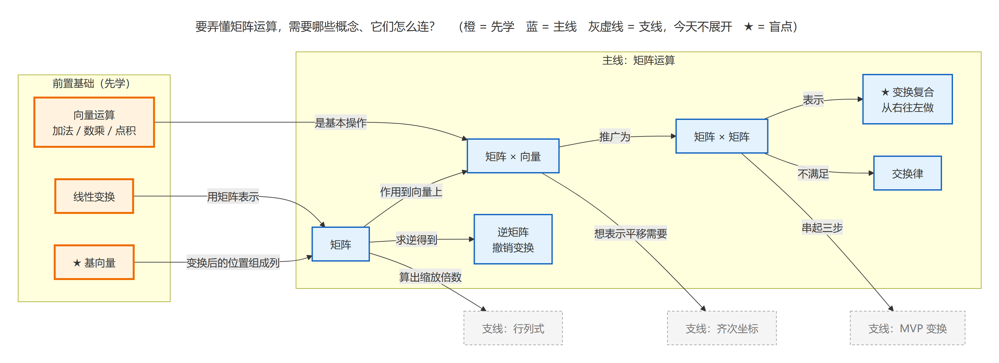

# study-diagram：把学习内容画成图

[中文](#中文) | [English](#english)

欢迎大家一起来优化这个流程，见[欢迎一起优化](#欢迎一起优化)。Everyone is welcome to help improve this workflow. See [Help improve it](#help-improve-it).



## 中文

`study-diagram` 是一个 AI skill。它把对话里讲过的知识画成图，回答学习时最常卡住的两个问题：

- **路线**：要学懂它，还得先懂哪些？有哪些没听过的环节？
- **顺序**：这些知识点在实际过程中按什么先后发生？

Claude Code、Codex、Antigravity 都能读这个 skill，Grok 和 Cursor 读 Claude 的目录。当前版本 v0.3。

上图是说一句「今天要学矩阵运算，先画个联系图」得到的学前地图。橙色是要先学的基础，蓝色是今天的主线，灰色虚线是今天不展开的支线，★ 是容易漏掉的盲点。

### 由来

这个 skill 来自一份 10 周学习计划。最早它只做两件事：把对话里讲清楚的知识画成图，核对已有的学习图。

用了一段时间，发现只画时序图会丢知识点。有一张时序图改了好多遍，每次都落下几个点。原因是时序图只回答「先后」，回答不了「还缺什么」。比如学 GPU 时，只知道「驱动 → 显存」，不知道中间还有 GPU 拷贝引擎。这种没听过的环节，在时序图里根本不会出现。

所以 v0.2 加了关联图：学之前先画一张地图，把前置基础、主线、支线和盲点摆出来，再按需要画时序图。v0.3 把 skill 拆成模块，写好维护规则，换任何一个 AI 都能接着改。

完整的原始想法见 [docs/核心想法.md](docs/核心想法.md)，每版改了什么见 [docs/变更日志.md](docs/变更日志.md)。

### 目的

主要目的是把零散的知识点串起来，并且不漏点。具体有三条：

1. 学之前看清路线。构成主题的基础知识是重点。不懂向量运算和线性变换，就学不懂矩阵运算。
2. 区分主线和支线。每次学习都有具体计划，图围绕当天主线，不画太多。
3. 学之后把知识串起来，并按先后顺序固定下来，方便以后复习。

图要拿来反复复习，所以内容错一处比画得丑更糟。skill 先保证事实对，再保证图看得清。

### 功能

skill 有 5 个模块。用户不用记模块名，按平时的说法提出要求，AI 会选对应的模块。

| 模块 | 怎么说 | 出什么图 |
|---|---|---|
| 路线 · 学前地图 | 「今天要学 X」「先画个联系图」 | 关联图：前置基础、主线、支线，标出盲点 |
| 学后串联 | 「把今天学的串起来」「它们什么关系」 | 关联图：把零散知识点连起来 |
| 顺序 · 时序图 / 流程图 | 「这个过程画成时序图」 | mermaid 时序图或流程图 |
| 核对已有图 | 「这图对吗」「有问题的改一下」 | 纠错后重画，改过的地方标红 |
| 函数曲线 | 「画个曲线」「参数怎么影响结果」 | matplotlib 曲线图 |

每个模块都按同一套流程走：

1. 把要上图的知识点编号（K1、K2……）。
2. 写 mermaid 或 matplotlib 源码，渲染成 PNG。
3. 打开 PNG 检查文字截断、连线缠绕、标签压线，有问题就改了重画。
4. 拿编号清单逐条核对。放不进主线的知识点放进「待关联」区，不丢掉。

另外两条规矩：

- 版本号、默认值、硬件参数这类会过时的事实，先搜索确认再画进图里。
- 图默认只发给用户看，不存档。用户说存，才存到指定位置。

关联图的画法借鉴了 LLMapper、Metacademy、Novak 概念图等项目，来源和取舍见 [docs/借鉴记录.md](docs/借鉴记录.md)。

### 安装

需要 Python 3、Chrome 或 Edge（渲染 mermaid，需要联网），画曲线还需要 `matplotlib`。

1. 克隆本仓库。
2. 把 `skill/` 链接到 AI 的全局 skills 目录。以 Claude Code 为例，在 Windows 上运行：

	```bash
	cmd /c mklink /J "%USERPROFILE%\.claude\skills\study-diagram" "<仓库路径>\skill"
	```

3. `skill/SKILL.md` 里的渲染命令写的是作者的路径 `C:/Users/21265/.claude/skills/study-diagram/...`。把它换成你自己的 skills 目录。

装好后，对 AI 说「今天要学矩阵运算，先画个联系图」，应该得到一张和上图结构相同的学前地图。

### 仓库结构

```text
├─ AGENTS.md            维护规则，任何 AI 改 skill 前都要读
├─ skill/               skill 正本
│   ├─ SKILL.md         总流程和模块目录
│   ├─ modules/         每个模块一个文件
│   ├─ references/      学科易错点（渲染、数学）和布局问题的修法
│   └─ scripts/         render.py（mermaid）、plot.py（matplotlib）
├─ docs/                核心想法、借鉴记录、路线图、变更日志
├─ tests/               样例源码和期望要点，改完重画对照
└─ scripts/检查.ps1      检查行数、模块目录和模块格式
```

### 欢迎一起优化

这个流程还在不断改进，欢迎大家一起来优化。

- **提 Issue**：哪张图漏了知识点、画错了，或者连线看不清，把截图和你说的那句话贴到 [Issues](https://github.com/smartrick125/study-diagram/issues)。
- **分享做法**：你知道哪个项目或方法画学习图画得好，也欢迎发 Issue 推荐，我们会记进 [docs/借鉴记录.md](docs/借鉴记录.md)。
- **提 PR**：改 skill 前先读 [AGENTS.md](AGENTS.md)。新模块要先调研，改完重画 `tests/` 里的样例，并让 `scripts/检查.ps1` 全部通过。

### 接下来

候选模块有「下一步学什么」「一份数据出两种图」「跨天知识库」等，状态见 [docs/路线图.md](docs/路线图.md)。加新模块的流程见 [AGENTS.md](AGENTS.md) 第三节：先记想法，再调研至少 3 个类似项目，然后实现和验证。

## English

`study-diagram` is an AI skill. It turns what you learned in a conversation into diagrams that answer the two questions learners get stuck on most:

- **Route**: What else do I need to know before I can understand this topic? Which steps have I never heard of?
- **Order**: In what order do these concepts happen in the real process?

Claude Code, Codex, and Antigravity read this skill. Grok and Cursor read it from the Claude directory. Current version: v0.3.

The diagram at the top of this page is a pre-study map. It came from one sentence: "Today I want to learn matrix operations, draw me a map first." Orange boxes are prerequisites to learn first. Blue boxes are today's main topic. Gray dashed boxes are side topics that today's session does not expand. A ★ marks a blind spot that learners often miss.

### Origin

The skill started as part of a 10-week study plan. At first it did two things: draw diagrams of knowledge explained in a conversation, and check existing study diagrams for mistakes.

After some use, sequence diagrams alone kept losing concepts. One sequence diagram took many rounds of fixes, and every round left a few points out. A sequence diagram answers "in what order" but not "what is missing". For example, while studying GPUs, the learner knew "driver → video memory" but did not know about the GPU copy engine in between. A step you have never heard of never shows up in a sequence diagram.

So v0.2 added concept maps. Before studying, the skill draws a map of prerequisites, the main topic, side topics, and blind spots. Sequence diagrams come after, when needed. v0.3 split the skill into modules and wrote maintenance rules, so any AI can continue the work.

The original ideas are in [docs/核心想法.md](docs/核心想法.md) and the version history is in [docs/变更日志.md](docs/变更日志.md). Both are in Chinese.

### Purpose

The main purpose is to connect scattered concepts without losing any of them. In detail:

1. See the route before studying. The foundations of a topic matter most. Without vector operations and linear transformations, you cannot understand matrix operations.
2. Separate the main topic from side topics. Every session follows a concrete plan, so the map stays focused on the day's main topic and does not grow too large.
3. After studying, connect what you learned and fix it in order, so you can review it later.

You will review these diagrams many times, so one wrong fact costs more than an ugly layout. The skill gets the facts right first, then makes the diagram readable.

### Features

The skill has five modules. You do not need to remember module names. Ask in your own words and the AI picks the module.

| Module | What you say | What you get |
|---|---|---|
| Route: pre-study map | "Today I want to learn X", "Draw a map first" | Concept map with prerequisites, main topic, side topics, and blind spots |
| Post-study links | "Connect what I learned today", "How are these related?" | Concept map that links scattered concepts |
| Order: sequence or flow diagram | "Draw this process as a sequence diagram" | Mermaid sequence diagram or flowchart |
| Check an existing diagram | "Is this diagram right?", "Fix what is wrong" | Corrected diagram with changed parts in red |
| Function curves | "Plot this curve", "How does this parameter change the result?" | Matplotlib plot |

Every module follows the same steps:

1. Number each concept that goes on the diagram (K1, K2, and so on).
2. Write Mermaid or Matplotlib source and render it to PNG.
3. Open the PNG and check for cut-off text, tangled lines, and labels on top of lines. Fix and render again if needed.
4. Check the numbered list against the diagram, one item at a time. A concept that does not fit the main topic goes into a "to be linked" area instead of being dropped.

Two more rules:

- The skill searches to confirm facts that go out of date, such as version numbers, default values, and hardware specs, before it draws them.
- By default the skill only shows diagrams to you and saves nothing. It saves files only when you ask, to the location you name.

The concept map method borrows from LLMapper, Metacademy, and Novak concept maps. Sources and trade-offs are in [docs/借鉴记录.md](docs/借鉴记录.md) (Chinese).

### Install

You need Python 3 and Chrome or Edge to render Mermaid, with an internet connection. Function curves also need `matplotlib`.

1. Clone this repository.
2. Link `skill/` into your AI's global skills directory. For Claude Code on Windows, run:

	```bash
	cmd /c mklink /J "%USERPROFILE%\.claude\skills\study-diagram" "<repo path>\skill"
	```

3. The render commands in `skill/SKILL.md` use the author's path `C:/Users/21265/.claude/skills/study-diagram/...`. Replace it with your own skills directory.

To test the install, tell your AI "Today I want to learn matrix operations, draw me a map first." You should get a pre-study map with the same structure as the diagram above.

### Repository layout

```text
├─ AGENTS.md            Maintenance rules. Every AI reads them before changing the skill
├─ skill/               The skill itself
│   ├─ SKILL.md         Main workflow and module list
│   ├─ modules/         One file per module
│   ├─ references/      Common mistakes by subject (rendering, math) and layout fixes
│   └─ scripts/         render.py (Mermaid), plot.py (Matplotlib)
├─ docs/                Core ideas, research notes, roadmap, changelog
├─ tests/               Sample sources and expected points, re-rendered after each change
└─ scripts/检查.ps1      Checks line counts, the module list, and module format
```

### Help improve it

This workflow is still evolving, and everyone is welcome to help improve it.

- **Open an issue**: If a diagram missed a concept, got a fact wrong, or has lines that are hard to follow, post a screenshot and the sentence you said in [Issues](https://github.com/smartrick125/study-diagram/issues).
- **Share a method**: If you know a project or method that draws good study diagrams, recommend it in an issue. We record what we borrow in [docs/借鉴记录.md](docs/借鉴记录.md).
- **Send a pull request**: Read [AGENTS.md](AGENTS.md) before you change the skill. A new module needs research first. After a change, re-render the samples in `tests/` and make `scripts/检查.ps1` pass.

### What comes next

Candidate modules include "what to learn next", "one data source for two diagram types", and "a knowledge base across days". Their status is in [docs/路线图.md](docs/路线图.md). The process for adding a module is in section 3 of [AGENTS.md](AGENTS.md): record the idea, study at least three similar projects, then build and verify.
